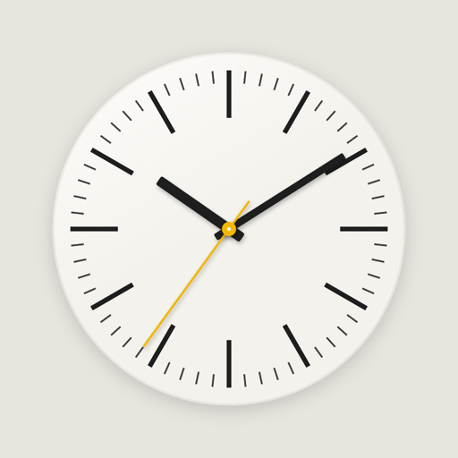

# Takt für Mac

Eine ruhige, analoge Uhr im Geist von Bauhaus und Dieter Rams.

**Webseite: [takt-uhr.de](https://takt-uhr.de)**

- Vollbild-Uhr mit sechs Farben, „Nachts dunkel“ nach Systemmodus, vier Bewegungen (Gleitend, Mechanik, Quarz, Bahnhof)
- Menüleisten-Uhr, immer im Vordergrund, durchsichtig, magnetische Ecken, Autostart
- Fokus-Timer direkt auf dem Zifferblatt
- Widget und Bildschirmschoner inklusive

## Download

**[Takt.dmg laden](https://github.com/mschabbing/Takt-App/releases/latest/download/Takt.dmg)** – Universal (Apple Silicon und Intel), ab macOS 15.

## Installation

1. DMG öffnen und „Takt“ auf „Programme“ ziehen.
2. Takt ist nicht von Apple notarisiert. Einmal freigeben – im Terminal:

   ```bash
   xattr -dr com.apple.quarantine /Applications/Takt.app
   ```

   Oder ohne Terminal: Takt öffnen, die Warnung schließen, dann
   Systemeinstellungen ▸ Datenschutz & Sicherheit ▸ „Dennoch öffnen“.
3. Bildschirmschoner (optional): In Takt die Einstellungen öffnen (⌘,) ▸ Tab „Bildschirmschoner“ ▸ „Bildschirmschoner installieren…“.
4. Widget (optional): Rechtsklick auf den Schreibtisch ▸ Widgets bearbeiten… ▸ „Takt“ suchen.

Der Quellcode ist nicht öffentlich. Dieses Repository enthält nur die fertige App als Release.
